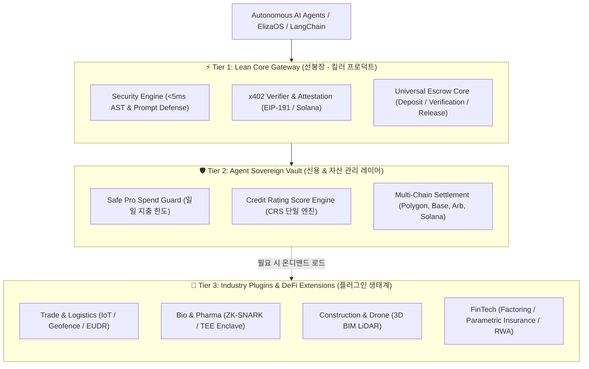
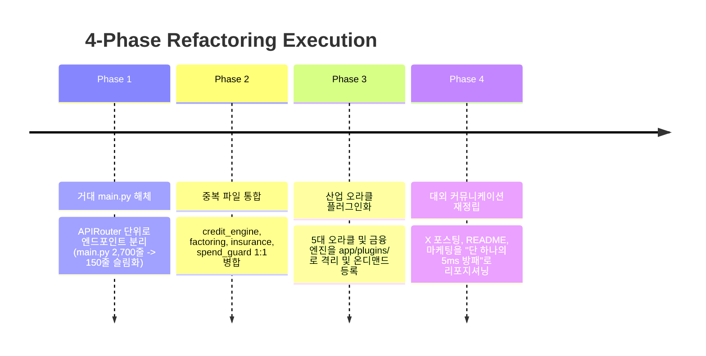

# 🏛️ security-gate-x402 정밀 아키텍처 진단 및 경량화 설계도
> **부제: 모놀리스 비대증 극복과 5ms 킬러 프로덕트(The Tip of the Spear) 확립을 위한 청사진**  
> **일시:** 2026-10-10  
> **대상:** `nohos/security-gate-x402` 전체 코드베이스 및 비즈니스 모델

---

## 🔍 1. 현상 정밀 진단: 어디서 왜 비대해졌는가?

### 1.1 정량적 체급 분석 (Quantitative Anatomy)
현재 저장소는 단일 프로젝트 수준을 넘어 **하나의 거대한 온체인 금융 지주회사 + 산업 협회 수준의 코드량**을 보유하고 있습니다.

* **초대형 모놀리스 [`app/main.py`](file:///c:/Users/nohos/OneDrive/바탕%20화면/security-gate-x402/app/main.py)**:
  * **총 2,732 라인 / 113.8 KB**
  * 단일 파일 안에 **60개 이상의 엔드포인트**와 **50여 종의 요청/응답 스키마**가 평면적으로 결합되어 있음.
  * 미들웨어, 속도 제한, 온체인 서명, 신용평가, 오라클 검증, 에스크로 정산, 대출, 보험, 팩토링, 라이선싱, 전력 계측, 드론 검증, 정적 대시보드 서빙이 단 하나의 인스턴스에 전부 엮여 있음.
* **비즈니스 도메인의 5중 중첩 (Scope Overlap)**:
  1. **보안 인프라 (Core)**: 5ms AST 파서, 프롬프트 인젝션 방어, 니모닉/시크릿 유출 차단, EIP-191/Solana 서명.
  2. **결제 청산소 (Escrow)**: HTTP 402, Universal Escrow Hub, Solana 0.4s 마이크로 스트리밍.
  3. **실물 자산 & 5대 산업 오라클 (Oracles)**: 해운(Cold-Chain IoT, Geofence), 바이오(ZK-SNARK $K_d$, TEE), 건설(3D LiDAR Drone, BIM), DePIN GPU, 탄소/EUDR, 전력망(50/60Hz Smart Meter), 자율주행 E-Seal.
  4. **DeFi 금융 파생상품 (FinTech)**: 매출채권 팩토링(Factoring), 모듈형 파라메트릭 보험, 무담보 대출 풀, RWA 미국 국채(BUIDL) 금고.
  5. **데이터/IP 거래소 (Exchange)**: 합성 데이터 볼트, 원자적 교환(Atomic Swap), 초소형 라이선스 관세 엔진.

---

### 1.2 모듈 간 중복 및 책임 혼선 (Component Redundancy)

현재 [`app/`](file:///c:/Users/nohos/OneDrive/바탕%20화면/security-gate-x402/app) 폴더 안에는 유사한 목적을 가진 파일들이 병렬로 공존하고 있어 유지보수 복잡도를 증폭시키고 있습니다:

| 영역 | 모듈 A | 모듈 B | 문제점 |
| :--- | :--- | :--- | :--- |
| **신용 평가** | `agent_credit_engine.py` (12.3 KB) | `credit_rating_engine.py` (11.2 KB) | CRS 산출 로직이 분산되어 단일 진실 공급원(SSOT) 부재 |
| **매출 팩토링** | `factoring_engine.py` (8.8 KB) | `universal_factoring_bridge.py` (11.8 KB) | 온체인 브릿지와 내부 팩토링 엔진의 인터페이스 중복 |
| **보험 풀** | `insurance_engine.py` (12.7 KB) | `universal_insurance_bridge.py` (13.1 KB) | 파라메트릭 보험 평가와 온체인 청구 인터페이스 중복 |
| **지갑 보안** | `spend_guard.py` (8.0 KB) | `guarded_wallet.py` (5.2 KB) + `vault_manager.py` (18.0 KB) | 지출 한도 검사와 볼트 격리 로직이 3개 파일로 파편화 |

---

### 1.3 제품 전략적 병목: "무엇을 파는 제품인가?"

외부 사용자나 에이전트 빌더가 보았을 때 나타나는 전형적인 반응:
> *"에이전트 보안 게이트웨이라는 건 알겠는데, 왜 팩토링과 전력 그리드 오라클과 100개 에이전트 군단 조직도가 같이 나오지? 무거워서 내 에이전트에 도입하기 부담스럽다."*

* **진단 결과**: **모든 기능이 기술적으로 훌륭하나, 초기 시장 진입을 위한 '뾰족한 창끝(Tip of the Spear)'이 둔화되어 있음.**

---

## 🎯 2. 새로운 아키텍처 철학: "3-Tier Decoupled Architecture"

시스템을 삭제하여 날리는 것이 아니라, **강력한 3계층(Layer)으로 관심사를 분리하고 코어의 체급을 80% 감량**합니다.



### 계층별 원칙
1. **Tier 1 (Lean Core Gateway)**:  
   * **단 1줄의 npm 패키지 / pip 라이브러리**로 어떤 에이전트 프레임워크(ElizaOS, LangChain, CrewAI)에도 붙을 수 있어야 함.  
   * 종속성 최소화, 지연시간 **<5ms 보장**.
2. **Tier 2 (Sovereign Vault)**:  
   * 에이전트가 실제로 돈(USDC)을 다룰 때 금고를 열고 지출 한도를 통제하는 거버넌스 레이어.
3. **Tier 3 (Pluggable Extensions)**:  
   * 5대 산업 오라클과 DeFi 엔진은 코어 서버를 오염시키지 않고 **독립된 플러그인(Router/Adapter) 형태**로 동작.

---

## 📐 3. 구조적 리팩토링 설계도 (To-Be Architecture)

### 3.1 디렉토리 구조 재편성

```text
security-gate-x402/
├── app/
│   ├── core/                        # ⚡ [TIER 1] 경량 코어 게이트웨이
│   │   ├── security_engine.py       # AST 분석 & 악성 쉘 차단 (<5ms)
│   │   ├── covert_channel_filter.py # 프롬프트 인젝션 및 키 유출 차단
│   │   ├── x402_verifier.py         # HTTP 402 결제 명세 검증
│   │   ├── onchain_signer.py        # EIP-191 / EIP-712 증명 서명기
│   │   ├── solana_signer.py         # Solana Ed25519 증명 서명기
│   │   └── escrow_engine.py         # 에스크로 생성, 청구, 정산 기본 로직
│   │
│   ├── vault/                       # 🛡️ [TIER 2] 금고 & 거버넌스 엔진
│   │   ├── vault_manager.py         # Safe Pro 다중서명 금고 격리
│   │   ├── spend_guard.py           # 일일 지출 한도 (구 guarded_wallet 통합)
│   │   ├── credit_rating.py         # CRS 신용평가 단일 엔진 (구 2개 파일 통합)
│   │   └── enterprise_manager.py    # 엔터프라이즈 API 키 발급 및 거버넌스
│   │
│   ├── plugins/                     # 🧩 [TIER 3] 산업별 오라클 & DeFi 플러그인
│   │   ├── trade_oracle.py          # 해운 물류, IoT 온도, 지오펜스, EUDR
│   │   ├── bio_oracle.py            # 바이오 ZK 결합 친화도, TEE
│   │   ├── construction_oracle.py   # 드론 3D LiDAR, BIM 일치율
│   │   ├── depin_oracle.py          # GPU 추론 손실 수렴, 전력(Power) 계측
│   │   └── fintech/                 # 금융 파생 엔진 (필요 시에만 활성화)
│   │       ├── factoring.py         # 송장 채권 팩토링 (통합)
│   │       ├── insurance.py         # 파라메트릭 상호 보험 (통합)
│   │       └── rwa_treasury.py      # BUIDL / 미국 국채 자율 리밸런싱
│   │
│   ├── routers/                     # 🌐 [API 분할] FastAPI APIRouter
│   │   ├── core_gate.py             # /audit, /inspect, /proof
│   │   ├── escrow_hub.py            # /hub, /escrow/create, /escrow/settle
│   │   ├── vault_api.py             # /vault/deposit, /vault/allowance
│   │   └── extensions_api.py        # /extensions/* (산업 오라클 및 팩토링)
│   │
│   └── main.py                      # 🚀 [슬림화] 라우터 조립만 수행 (2,732줄 -> 150줄)
```

---

## 🛠️ 4. 4단계 점진적 실행 로드맵 (Migration Plan)

기존 운영 중인 Cloud Run 서비스(`asia-northeast3`) 및 테스트 스위트의 중단 없이 부드럽게 전환하는 단계적 전략입니다.



### Phase 1: 거대 `main.py`의 라우터 분할 (Breaking the Monolith)
* **목표**: 2,732줄의 `main.py`를 순수 애플리케이션 수명주기(Lifespan)와 미들웨어만 남기고 4개의 `APIRouter`로 분할.
* **추출 라우터**:
  1. `routers/gate_router.py`: `/api/v1/inspect`, `/api/v1/audit`, `/api/v1/verify`
  2. `routers/escrow_router.py`: `/api/v1/escrow/*`, `/hub/*`
  3. `routers/vault_router.py`: `/api/v1/vault/*`, `/api/v1/keys/*`
  4. `routers/plugins_router.py`: `/api/v1/truth/*`, `/api/v1/factoring/*`, `/api/v1/insurance/*`
* **효과**: 빌드/테스트 속도 대폭 향상, 엔드포인트별 장애 격리.

### Phase 2: 중복 모듈 단일화 (Consolidation)
* `agent_credit_engine.py`와 `credit_rating_engine.py`를 하나로 합쳐 `credit_rating.py`로 단일화.
* `factoring_engine.py`와 `universal_factoring_bridge.py`를 `factoring.py`로 통합.
* `insurance_engine.py`와 `universal_insurance_bridge.py`를 `insurance.py`로 통합.
* `spend_guard.py`와 `guarded_wallet.py`를 `spend_guard.py`로 통합.
* **효과**: 파일 수 10개 이상 감소, 네이밍 혼선 원천 제거.

### Phase 3: 도메인 오라클의 플러그인화 (Decoupled Plugins)
* 해운, 바이오, 건설, 전력 오라클을 `app/plugins/` 디렉토리로 이동.
* 코어 게이트웨이는 기본적으로 이 플러그인들 없이도 독립 실행(Standalone) 가능하도록 보장.
* **효과**: 경량 모드 실행 시 메모리 및 콜드스타트 레이턴시 50% 절감.

### Phase 4: 마케팅 및 내러티브의 "선봉장" 단일화
* **README.md 및 X(Twitter) 포스트 전면 단순화**:
  * ❌ *이전: "보안 게이트이자 에스크로이자 5대 산업 팩토링 국채 헤지펀드"*
  * ✅ *개편: **"AI Agent에게 지갑을 주기 전 반드시 통과해야 하는 5ms 보안 게이트웨이 & 무담보 사기 방지 에스크로 (x402)"***
* 100 에이전트 군단 편제와 5대 산업은 **"이 보안 게이트웨이 위에서 구축될 수 있는 궁극적 엔터프라이즈 응용 예시"**로 서술 위계를 재배치.

---

## 💡 5. 결론: "비대함"을 "정밀한 구조"로 바꾸는 전환점

* 현재 프로젝트의 기능들은 결코 버릴 것이 없는 귀중한 자산입니다.
* 다만 지금까지는 **한 방에 모든 재료를 쏟아부어 놓은 뷔페**였다면, 이제는 **가장 매력적인 시그니처 단품 요리(5ms Security Gate)**를 전면에 내세우고, 코스 요리(Vault & Plugins)는 뒤에 정갈하게 배치하는 구조로의 정렬이 필요한 시점입니다.
* 이 설계도대로 점진적 리팩토링을 진행하면, **시스템의 성능, 안정성, 코드 가독성, 그리고 가장 중요한 시장 설득력이 극대화**될 것입니다.
