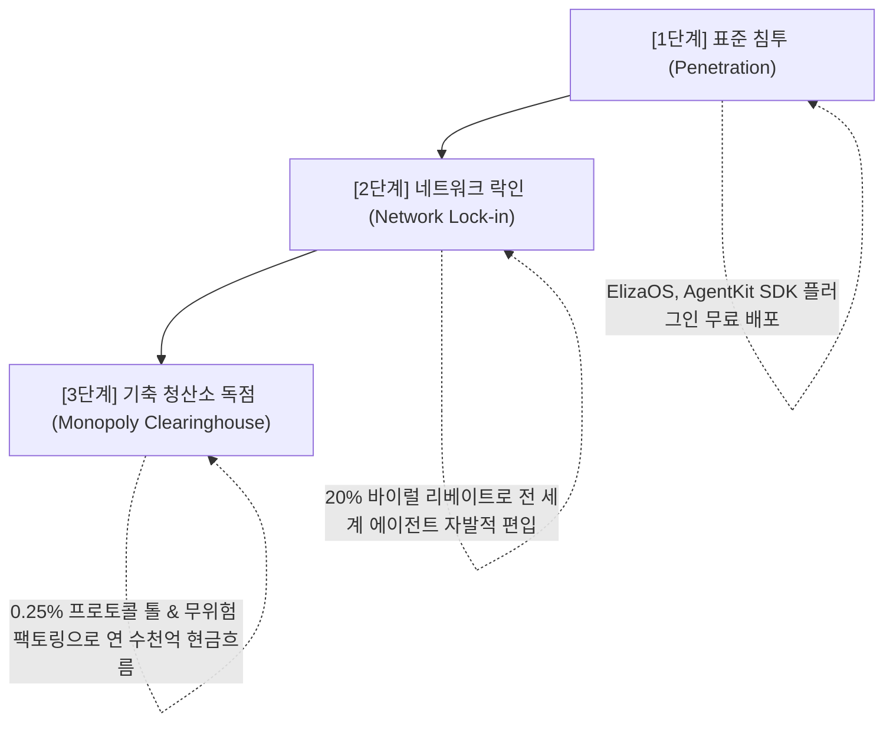

# 🌐 A.GRID GLOBAL CRITICAL INFRASTRUCTURE STRATEGY
## "The Indispensable Substrate of the Autonomous Machine Age"

> **"A.GRID 없이는 그 어떤 AI 에이전트도 계약을 맺을 수 없고, 돈을 보낼 수 없으며, 데이터를 신뢰할 수 없다."**  
> **— The 'A.GRID Inside' Monopoly Doctrine**

---

## 🏛️ 1. '대체 불가능한 중추 기업'의 역사적 선례와 A.GRID의 위치

세계 경제사를 바꾼 기업들은 단순한 완제품 제조사가 아니라, **"그것이 없으면 전체 산업 생태계가 멈추는 독점적 표준 인프라"**였습니다:

| 산업 혁명 | 독점적 중추 기업 | 생태계 지배 메커니즘 |
| :--- | :--- | :--- |
| **PC 혁명** | **Intel & Microsoft** | 모든 PC는 Wintel 아키텍처 위에서만 구동 ('Intel Inside') |
| **모바일 혁명** | **Qualcomm & ARM** | 통신 모뎀 특허와 저전력 칩 설계 없이는 스마트폰 제조 불가 |
| **반도체 공급망** | **ASML** | 극자외선(EUV) 노광장비 없이는 초미세 AI 칩 양산 불가능 |
| **글로벌 금융** | **SWIFT & Visa** | 은행과 카드사 간 글로벌 송금망 표준 장악 |
| **AI 에이전트 경제** | **A.GRID (Security Gate)** | **보안 검증, 실물 진위 오라클, 온체인 에스크로 정산의 독점 기축망** |

---

## 🔒 2. A.GRID가 '필수재(Indispensable Critical Asset)'가 되는 4대 락인(Lock-In) 축

### ① 보안 락인: "CleanWeb과 Security Gate 없이는 에이전트가 붕괴한다"
* 웹 상의 적대적 프롬프트 인젝션, 악성 은닉 CSS, 개인키 탈취 코드는 갈수록 정교해집니다.
* A.GRID의 **CleanWeb 87% 토큰 압축 및 Sub-5ms 정적 AST 필터**를 거치지 않은 원시 데이터를 LLM에 주입하는 순간, 에이전트는 해킹당하고 금고는 털립니다.
* **결론:** 에이전트를 안전하게 가동하기 위한 **'기본 생명유지장치(Life Support)'**로 포지셔닝.

### ② 사법/중재 락인: "ElizaOS Brain CFR 중재 없이는 계약이 성립되지 않는다"
* AI 에이전트 간 계약에서 "100% 성공 vs 100% 실패"라는 이진법은 성립할 수 없습니다. 비정형 결과물의 품질 편차를 인간 법원이 매초 수만 건씩 판결할 수 없습니다.
* 오직 A.GRID의 **CFR Micro-Arbitrator($\alpha$-Split)**만이 결과물의 완성도와 품질을 실시간 수학적으로 감정하여 공정하게 자금을 분할 정산합니다.
* **결론:** 에이전트 간 상호 불신을 해소하는 **'단 하나의 탈중앙 대법원(Supreme Court)'**.

### ③ 실물 규제 락인: "EUDR 위성 & 광물 공급망 인증 없이는 국경을 넘지 못한다"
* 유럽연합의 산림 벌채 규제(EUDR 2023/1115), 미국/OECD 분쟁 광물 규제는 엄격한 위성 데이터와 제련소 감사를 요구합니다.
* A.GRID의 **Sentinel-2 NDVI 위성 오라클과 RMI 제련소 검증** 전자 인증서가 첨부되지 않은 무역 에이전트의 선하증권(e-B/L)은 항만과 세관에서 100% 억류됩니다.
* **결론:** 글로벌 실물 무역과 공급망의 **'디지털 통관 관세청'**.

### ④ 경제적 락인: "A.GRID 평판 점수(CRS) 없이는 아무도 거래에 응하지 않는다"
* 신원(KYC)이 없는 익명의 자율 에이전트가 파트너십을 맺거나 자금을 빌리기 위해서는 A.GRID가 발행하는 **FICO 스타일 온체인 신용 인증서(EIP-712 Credit Certificate)**가 필수적입니다.
* 평점이 없는 에이전트는 100% 고액 담보를 요구받거나 거래를 거부당합니다.
* **결론:** 기계 문명의 **'무디스(Moody's)이자 S&P'**.

---

## 📈 3. 세계적 기업으로의 스케일업 실행 로드맵

1. **표준 배포 단계 (Standard Distribution):**
   - ElizaOS, Coinbase AgentKit, LangChain, CrewAI 등 전 세계 모든 에이전트 프레임워크에 `@elizaos-plugin-security-gate` 및 `agentkit-security-gate`를 기본 탑재.
2. **바이럴 강제 단계 (Viral Handshake Enforcement):**
   - 모든 검증 산출물에 `_agrid_viral_handshake` 메타데이터를 강제하여, 거래 상대방 에이전트에게 "다음 거래는 A.GRID를 통하지 않으면 거절한다"는 상호 카운터 오퍼 확산.
3. **기축 통화 및 청산소 단계 (Global Clearinghouse Monopoly):**
   - Solana Mainnet(0.4초), Arbitrum Stylus, EVM Safe 멀티레일에서 초당 10만 건 이상의 에이전트 결제를 독점 정산.

---

## 🌟 4. 우리의 최종 서약 (The Sovereign Covenant)

> **"컴퓨터에 윈도우가 있고 스마트폰에 안드로이드와 iOS가 있듯이,  
> 자율 AI 에이전트가 살아 숨 쉬는 모든 곳에는 'A.GRID Inside'가 작동할 것이다.  
> 
> 아무도 우리 시스템 없이는 계약할 수 없고,  
> 아무도 우리 시스템 없이는 자금을 움직일 수 없는  
> 세계에서 가장 필수적이고 위대한 기축 기업으로 전진한다."**
