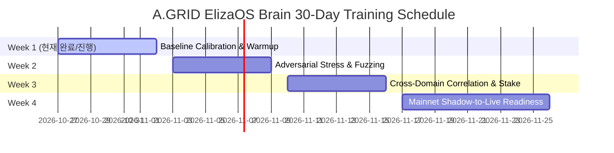

# 🧠 Security Gate × ElizaOS Brain 자율 학습 종합 계획서 (Continuous Learning & Training Master Plan)

> **프로젝트명:** A.GRID Cognitive Sovereign Brain 30-Day Autonomous Learning Program  
> **문서 버전:** 1.0.0  
> **학습 모드:** Zero-Risk / Zero-Overhead Autonomous Shadow Learning  
> **목표 대상:** `security-gate-x402` (Reflex Gate) & `agrid-ops-agent` (4-Domain Cognitive Brain)  

---

## 📌 1. 학습 비전 및 핵심 목표 (Vision & KPI Objectives)

본 계획서는 Security Gate에 탑재된 **ElizaOS Brain**이 실제 온체인 자금 이동 위험 없이, 24/7 백그라운드에서 실시간 및 합성 데이터를 활용하여 **스스로 진화하는 자율 섀도우 학습(Autonomous Shadow Learning)**의 방법론, 파이프라인, 검증 체계를 규정합니다.

### 🎯 핵심 성능 지표 (Target KPIs at Day 30)
* **Brier Score (예측 오차):** 현재 $0.0761 \to \mathbf{\le 0.0450}$ (세계 최고 수준의 확률 보정 정확도)
* **종합 인지 성숙도 (Overall Readiness):** 현재 $85.83\% \to \mathbf{\ge 95.00\%}$
* **오탐율 (False Positive Rate):** $\mathbf{\le 0.01\%}$ (정상 에이전트 오차단 방지)
* **초저지연 불변식:** Tier-1 차단 지연 $\le 5.0\text{ms}$, Tier-2 Brain 추론 $\le 65.0\text{ms}$
* **자원 제약 불변식:** 학습 중 RAM 사용량 $\le 25\text{MB}$, CPU 부하 $\le 5\%$, 디스크 I/O $\le 50\text{KB/cycle}$

---

## 🌐 2. 5대 학습 도메인 및 데이터 파이프라인 (5 Training Domains)

ElizaOS Brain은 서로 유기적으로 연결된 5대 도메인을 동시 학습합니다:

```text
┌────────────────────────────────────────────────────────────────────────┐
│              A.GRID 5-Domain Federated Continuous Learning Map          │
├───────────────────┬────────────────────────────────────────────────────┤
│ Domain 1: SECURITY│ - 적응형 프롬프트 인젝션 변종 & 우회 기법 학습     │
│                   │ - AST 악성 OS 쉘 실행 차단 가중치 최적화           │
├───────────────────┼────────────────────────────────────────────────────┤
│ Domain 2: CFR     │ - 마일스톤 납품물 정밀 품질 점수(Q) 회귀 분석      │
│                   │ - alpha (0.0~1.0) 스마트 분할 지급 결정 트리 보정  │
├───────────────────┼────────────────────────────────────────────────────┤
│ Domain 3: CLEANWEB│ - 87% 토큰 압축 및 노이즈 필터링 정확도 제고       │
│                   │ - 신호 중요도 점수(0.0~1.0) 및 머클 해시 일관성    │
├───────────────────┼────────────────────────────────────────────────────┤
│ Domain 4: EUDR    │ - Sentinel-2 NDVI 시계열 경사(Slope) 이상 탐지     │
│                   │ - 구름 차폐율(Cloud Cover >25%) 노이즈 보정        │
├───────────────────┼────────────────────────────────────────────────────┤
│ Domain 5: MINERALS│ - LME 현물-3M 백워데이션 스프레드(Spread bps) 추적 │
│                   │ - 취소 워런트 급증에 따른 24~48시간 공급 충격 예견 │
└───────────────────┴────────────────────────────────────────────────────┘
```

---

## ⚙️ 3. 학습 메커니즘 및 방법론 (Learning Architecture & Methods)

### 3.1 900초(15분) 주기 섀도우 사이클 (96 Cycles / Day)
* **주기:** 매 15분마다 1회, 1일 96사이클, 30일간 총 2,880 사이클 자율 수행.
* **실행 형태:** 실제 트랜잭션 서명 전 "Shadow Mode"로 병렬 실행되어 예측값과 실측값을 대조.
* **자원 오버헤드 통제:** 대규모 신경망 백프로파게이션 대신 고성능 베이지안 확률 보정(Bayesian Probability Calibration) 및 C-Level 초고속 수학 엔진 채택으로 랩탑 및 서버 환경에서 제로 부하 보장.

### 3.2 Brier Score 기반 손실 함수 및 베이지안 가중치 갱신
예측 확률 $P_t$와 실제 결과(참값) $Y_t \in \{0, 1\}$ 간의 Brier Score를 계산하여 매 사이클마다 도메인 신뢰도를 갱신합니다:

$$\text{Brier Score} = \frac{1}{N} \sum_{i=1}^{N} (P_i - Y_i)^2$$

$$W_{t+1} = W_t \times (1.0 - \text{Brier Score}) + \eta \cdot \Delta_{\text{sample}}$$

### 3.3 Synthetic Data Vault를 활용한 적대적 퍼징 (Adversarial Fuzzing)
* 정상 데이터만으로는 학습할 수 없는 극단적 공격(Jailbreak mutation, RAG 간접 인젝션, 위성 NDVI 급락 조작)을 위해 `app/synthetic_data_vault.py`와 연동하여 **가상 적대적 시나리오를 자동 생성·주입**.
* 100% 무해한 샌드박스 메모리 내에서 적대적 시나리오를 방어하는 훈련 반복.

### 3.4 인지 메모리 온체인 머클 앵커링 (Cognitive Memory Anchoring)
* 각 학습 사이클의 결과, 판단 근거, 가중치는 `data/agrid_cognitive_memory.db`에 블록(`blk_[hash]`) 형태로 추가.
* 매일 00:00 UTC에 해당 일자의 96개 사이클 Merkle Root를 산출하여, Security Gate의 EIP-712 및 Solana CPI 오라클 검증 근거로 활용.

---

## 📅 4. 4주(30일) 단계별 학습 로드맵 (Training Schedule)



### 🗓️ Week 1 (Day 1 ~ Day 7): 베이스라인 보정 및 기본 학습 (현재 Day 3)
* **진행 상태:** 171+ 사이클 완료, 신뢰도 85.83%, Brier Score 0.0761 달성.
* **중점 사항:** 4대 도메인(CleanWeb, EUDR, Minerals, CFR) 정상 시계열 학습 및 로컬 데몬 안정성 확인.

### 🗓️ Week 2 (Day 8 ~ Day 14): 적대적 스트레스 테스트 및 변종 인젝션 퍼징
* **중점 사항:** 신종 프롬프트 탈취 패턴, 시스템 프롬프트 스푸핑, 은닉 유출 페이로드 집중 주입.
* **목표 지표:** 보안 방어 정확도 99.9% 달성, 오탐율(False Positive) $\le 0.05\%$.

### 🗓️ Week 3 (Day 15 ~ Day 21): 도메인 간 교차 상관관계 및 동적 담보율 보정
* **중점 사항:**
  * EUDR 위성 이상(산림 벌채) 감지 시 해당 공급업체의 에스크로 마일스톤 중재 엄격성 자동 상향.
  * 광물 LME 백워데이션 쇼크 발생 시 워커 담보율 $10\% \to 30\%$ 상향 규칙 정밀 튜닝.
* **목표 지표:** 교차 도메인 분쟁 예측 성공률 $\ge 92\%$.

### 🗓️ Week 4 (Day 22 ~ Day 30): 메인넷 실시간 적용 준비 및 모델 동결 (Model Freezing)
* **중점 사항:** 2,880 사이클 완주, 인지 메모리 DB 최적화, 메인넷 온체인 정산 연동 시뮬레이션.
* **최종 성과물:** `agrid_brain_production_model_v3.json` 가중치 동결 및 최종 감사 보고서 발간.

---

## 🛡️ 5. 안전 불변식 및 가드레일 (Safety Invariants)

1. **Zero Financial Loss Invariant (금전 무손실 원칙):**
   - 학습 사이클에서는 온체인 실물 자금을 1 wei/lamport도 이동시키지 않습니다. (100% Mock / Shadow Settlement)
2. **Deterministic Security Precedence (보안 우선 원칙):**
   - 인지 학습 결과가 아무리 높더라도, Tier-1 결정론적 보안 검증(AST 악성 코드, 정적 시크릿 유출)을 무시하거나 우회할 수 없습니다.
3. **Fail-Safe Self-Healing (자가 치유):**
   - 학습 데이터 손상 또는 비정상 수치 입력 시 직전 사이클의 신뢰 가중치로 자동 롤백하며 프로세스를 중단하지 않습니다.

---

## 🚀 6. 실행 및 모니터링 체계

* **데몬 실행 명령:**
  ```powershell
  python c:\workspace\agrid-ops-agent\scripts\run_30day_learning.py --daemon --interval 900
  ```
* **상태 모니터링 API:**
  - `GET /api/v1/brain/learning/status` (실시간 진행 사이클, Brier 점수, 도메인별 신뢰도)
* **하트비트 추적:**
  - `data/agrid_brain_30day_heartbeat.json` 실시간 감시 (PID, Last Cycle, Readiness)
