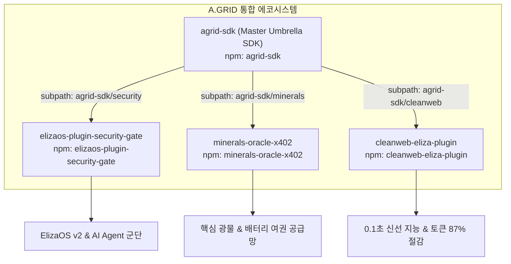

# 🌐 A.GRID Master NPM Ecosystem & Continuous Distribution Guide

> **표준 규격:** A.GRID AP2/1.0 Sovereign Machine-to-Machine NPM Network  
> **아키텍처:** GitHub Actions OIDC Provenance 무암호 배포 & 4대 패키지 통합 관제  
> **최종 갱신일:** 2026-10-21  

---

## 1. 4대 핵심 NPM 패키지 매트릭스

A.GRID 머신 에코시스템은 AI 에이전트, 자율 물리 오라클, 정밀 보안을 아우르는 4대 npm 패키지로 구성됩니다:



| 패키지 명칭 | 소속 레포지토리 | 로컬 소스 디렉터리 | 주요 역할 및 제공 기능 | npm 현황 |
| :--- | :--- | :--- | :--- | :---: |
| **`elizaos-plugin-security-gate`** | `security-gate-x402` | `packages/plugin-security-gate` | ElizaOS v2 프롬프트 인젝션 차단, Safe 다중서명 방화벽, x402 에스크로 | **✅ v2.5.2 (896+ DL)** |
| **`minerals-oracle-x402`** | `minerals-oracle-x402` | `sdk/typescript` | 핵심 광물 원산지 증명, EU 배터리 여권 검증, Pyth 시세 연동 M2M 무역 | **✅ v1.5.0 (Live)** |
| **`agrid-sdk`** | `security-gate-x402` | `packages/agrid-sdk` | 3대 영역을 단일 임포트로 연결하는 마스터 허브 SDK | **⏳ v1.0.0 (배포 대기)** |
| **`cleanweb-eliza-plugin`** | `x402-micro-agent` | `packages/plugin-cleanweb` | 87% 토큰 절감 광고/노이즈 제거 크롤링, Solana x402 결제 플러그인 | **⏳ v1.0.0 (배포 대기)** |

---

## 2. 통합 관제 CLI 대시보드 (`npm-ecosystem-manager`)

루트 디렉터리에서 단 한 줄의 명령어로 전체 npm 패키지의 로컬 버전, npm 라이브 최신 버전, 실시간 월간 다운로드 수치, 빌드 상태(`dist`)를 즉시 점검할 수 있습니다.

### 실시간 상태 확인
```bash
npm run npm:status
```

* **출력 예시**:
```text
==========================================================================================
 🌐 A.GRID Master NPM Ecosystem Status & Telemetry Dashboard
==========================================================================================

| Package Name | Repo | Local Ver | npm Live | Monthly DL | Build (dist) | Sync Status |
| :--- | :---: | :---: | :---: | :---: | :---: | :---: |
| elizaos-plugin-security-gate | security-gate-x402 | v2.5.2 | v2.5.2 | 896 | ✅ dist ready | ✅ Synced (Live) |
| minerals-oracle-x402 | minerals-oracle-x402 | v1.5.0 | v1.5.0 | 12 | ✅ dist ready | ✅ Synced (Live) |
| agrid-sdk | security-gate-x402 | v1.0.0 | vNot on npm | 0 | ✅ dist ready | ⏳ Pending 1st Publish |
| cleanweb-eliza-plugin | x402-micro-agent | v1.0.0 | vNot on npm | 0 | ✅ dist ready | ⏳ Pending 1st Publish |
```

### 마크다운 리포트 자동 생성
```bash
npm run npm:report
```
* 실행 즉시 [docs/NPM_ECOSYSTEM_STATUS.md](file:///c:/Users/nohos/OneDrive/바탕%20화면/security-gate-x402/docs/NPM_ECOSYSTEM_STATUS.md) 파일로 최신 현황이 문서화됩니다.

---

## 3. GitHub Actions CI/CD 무암호(OIDC Provenance) 배포 체계

모든 저장소는 **NPM 토큰 유출 위험이 없는 최신 보안 표준(OIDC Provenance)**을 따르도록 통일 구축되었습니다.

### 적용된 3대 워크플로
1. **`security-gate-x402`**: [.github/workflows/npm-publish.yml](file:///c:/Users/nohos/OneDrive/바탕%20화면/security-gate-x402/.github/workflows/npm-publish.yml)
   * `packages/plugin-security-gate` 및 `packages/agrid-sdk` 자동 빌드, 테스트, 배포.
2. **`minerals-oracle-x402`**: [.github/workflows/npm-publish.yml](file:///c:/Users/nohos/OneDrive/바탕%20화면/minerals-oracle-x402/.github/workflows/npm-publish.yml)
   * `sdk/typescript` 자동 빌드, 테스트, 배포.
3. **`x402-micro-agent`**: [.github/workflows/npm-publish.yml](file:///c:/Users/nohos/OneDrive/바탕%20화면/x402-micro-agent/.github/workflows/npm-publish.yml)
   * `packages/plugin-cleanweb` 자동 빌드, 배포.

### 핵심 동작 원리 (Safe Guardrail)
* **버전 사전 검사 (`npm view`)**:
  ```bash
  if npm view "$PKG_NAME@$PKG_VERSION" version >/dev/null 2>&1; then
    echo "Version $PKG_VERSION is already published on npm registry. Skipping."
    exit 0
  fi
  ```
  * 이미 npm에 배포된 버전이면 에러를 발생시키지 않고 안전하게 스킵하므로, 일반적인 코드 수정 푸시 시 CI 빌드가 깨지지 않습니다.
* **OIDC 암호학적 출처 증명 (`--provenance`)**:
  * GitHub 저장소 커밋 해시와 GitHub Actions 워크플로 서명이 npm 레지스트리에 영구 기록되어 위·변조가 원천 차단됩니다.

---

## 4. 신규 버전 배포 런북 (Release Playbook)

패키지를 신규 버전으로 배포하고자 할 때는 다음 순서로 진행합니다:

### Step 1: 해당 패키지의 `package.json` 버전 수정
* 예: `minerals-oracle-x402/sdk/typescript/package.json`의 `"version": "1.5.0"` $\to$ `"1.5.1"`
* 예: `security-gate-x402/packages/plugin-security-gate/package.json`의 `"version": "2.5.2"` $\to$ `"2.5.3"`

### Step 2: 로컬 빌드 및 테스트 확인
```bash
# 예시: minerals oracle의 경우
cd c:\Users\nohos\OneDrive\바탕 화면\minerals-oracle-x402\sdk\typescript
npm run build && npm test
```

### Step 3: Git 커밋 & 푸시
```bash
git add .
git commit -m "chore(release): bump package version to X.Y.Z"
git push origin main
```
* `origin/main`으로 푸시되는 즉시 GitHub Actions가 자동으로 빌드를 실행하고 npm에 신규 버전을 배포합니다.

### Step 4: 통합 대시보드에서 실시간 반영 확인
```bash
cd c:\Users\nohos\OneDrive\바탕 화면\security-gate-x402
npm run npm:status
```
* npm 레지스트리에 배포된 최신 버전이 실시간으로 확인됩니다.
