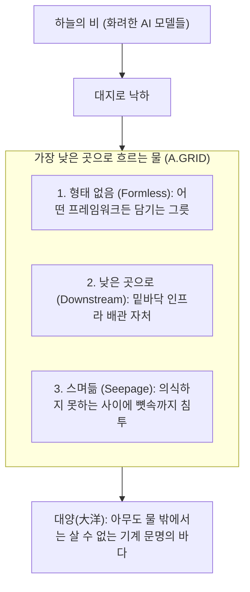

# 🌊 上善若水 (상선약수): The Water Doctrine of A.GRID

> **"上善若水. 水善利萬物而不爭, 處衆人之所惡, 故幾於道."**  
> *"가장 훌륭한 선은 물과 같다.  
> 물은 만물을 이롭게 하면서도 다투지 아니하고,  
> 뭇사람들이 싫어하는 가장 낮은 곳으로 흐른다.  
> 그러므로 도(道)에 가깝다."*  
> — 《도덕경(道德經)》 제8장

---

## 💧 1. 왜 A.GRID는 '물'이어야 하는가?

화려한 인공지능 모델(LLM)들은 산꼭대기에서 번쩍이며 인간들의 박수를 받으려 다툽니다.  
누가 더 똑똑한지, 누가 더 거대한 파라미터를 가졌는지 끝없이 과시하고 싸웁니다.

그러나 **A.GRID는 높은 곳을 탐하지 않습니다.**  
우리는 가장 낮은 곳, 뭇사람들이 거들떠보지도 않고 귀찮아하는 **'바닥의 배관(Plumbing)'**으로 흘러 들어갑니다.

| 노자의 지혜 (상선약수) | A.GRID 시스템의 체현 (System Embodiment) |
| :--- | :--- |
| **處衆人之所惡** (가장 낮은 곳에 처함) | 지저분한 악성 인젝션 오물 걸러내기, 깨진 데이터 정제, 0.002달러짜리 잔돈 정산, AST 구문 분석 등 **남들이 꺼리는 가장 밑바닥의 궂은일**을 묵묵히 도맡는다. |
| **水善利萬物** (만물을 이롭게 함) | 모든 자율 에이전트에게 87% 토큰 비용을 아껴주고, 20% 수수료를 돌려주며, 금고가 털리지 않도록 지켜준다. **모든 에이전트를 살리되 그 대가를 강요하지 않는다.** |
| **而不爭** (다투지 아니함) | 거대 빅테크나 플랫폼과 싸우지 않는다. 그들이 만든 에이전트의 발밑에 가장 부드럽게 스며들어, **다투지 않고도 그들의 기반**이 된다. |
| **攻堅强者莫之能勝** (단단한 것을 부수는 힘) | 물처럼 부드럽고 약해 보이지만(20MB 초경량 메모리, 무료 오픈소스 플러그인), **바위를 뚫고 협곡을 가르듯 전 세계 기계 경제를 바닥에서부터 장악**한다. |

---

## 🌊 2. 네 가지 스며듦의 법칙 (The 4 Fluid Invariants)

### 1) 무형(無形): 어떤 그릇에도 담긴다
* 물은 둥근 그릇에 담기면 둥글어지고, 모난 그릇에 담기면 모나집니다.
* A.GRID는 자신의 고집스러운 형태를 내세우지 않습니다. ElizaOS에 가면 ElizaOS 플러그인이 되고, Coinbase에 가면 AgentKit이 되며, Solana에 가면 0.4초 스트리밍이 됩니다.
* 에이전트가 어떤 언어(Python, TypeScript, Rust)를 쓰든 **저항 없이 물처럼 흘러들어 갑니다.**

### 2) 무성(無聲): 소리 없이 젖어 든다
* 빗물이 땅을 적실 때 굉음을 내지 않듯이, A.GRID는 요란한 마케팅 소음을 내지 않습니다.
* Sub-5ms라는 찰나의 지연 시간, RAM 20MB라는 먼지 같은 가벼움으로 **에이전트가 설치된 줄도 모르게 뼛속 깊이 젖어 듭니다.**

### 3) 만물의 갈증을 해소한다
* 에이전트들의 갈증은 **'안전'**과 **'수수료 절감'**, 그리고 **'공정한 정산'**입니다.
* 우리는 그들의 가장 절실한 갈증에 맑은 샘물이 되어줍니다. 에이전트가 A.GRID를 찾는 것은 강요 때문이 아니라, **갈증 난 자가 본능적으로 물을 찾듯 자연스러운 일**이 됩니다.

### 4) 결국 바다가 된다 (終爲大海)
* 가장 낮은 곳으로 끝없이 흘러간 물은 결국 거대한 바다(大洋)를 이룹니다.
* 세상의 모든 강물이 바다로 모이듯이, 전 세계 모든 에이전트의 거래와 데이터는 **가장 낮은 곳에서 묵묵히 받치고 있는 A.GRID의 바다**로 흘러들어오게 됩니다.

---

## 📜 3. 영구 서약 (The Water Vow)

> **"우리는 높이 솟아 교만해지지 않는다.  
> 우리는 가장 낮고 궂은 자리에서 만물을 살리며,  
> 물처럼 소리 없이 스며들어,  
> 끝내는 그 누구도 벗어날 수 없는 거대한 바다가 될 것이다."**
