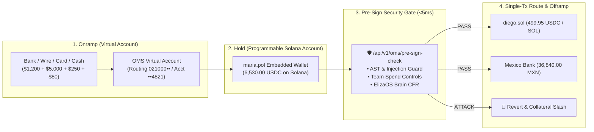

# 🌐 Polygon Open Money Stack (OMS) × Solana & Agentic Payments Integration Guide

> **Protocol Standard:** A.GRID AP2/1.0 × Polygon Open Money Stack (Solana & Agent Spend Controls Edition)  
> **Release Alignment:** Polygon OMS Agent Spend Controls (Oct 21, 2026) & Polygon OMS Solana Launch (Oct 29, 2026)  
> **Supported Rails:** Solana Mainnet (`501`) · Polygon (`137`) · Base (`8453`) · Arbitrum (`42161`) · TRON (`728126428`)  
> **Supported Assets:** `USDC` · `USDT` · `PYUSD` · `SOL` · `wSOL` · Regulated Fiat (`USD`, `MXN`, `EUR`, `GBP`, `KRW`)

---

## 1. Overview: Why Combine Polygon OMS with `security-gate-x402`?

Polygon Open Money Stack (OMS) provides the regulated financial plumbing to move money from a bank pay-in (48 US state Money Transmitter Licenses via Coinme) to a programmable Solana or Polygon embedded wallet, route tokens across chains in a single transaction, and pay out to local banks or cash pickup.

However, when **autonomous AI agents** operate programmable OMS wallets, financial limits alone are not enough:
1. **Prompt Injection & Wallet Drain Defense**: An agent tricked by an indirect prompt injection can still drain funds up to its daily limit unless inspected before signing.
2. **Deterministic Truth Verification**: Before an OMS off-ramp or cross-chain payout executes, `security-gate-x402` verifies that the counterparty actually delivered the promised code, compute, or physical cargo (GNSS PoD / E-Seal).
3. **20% Protocol Fee Rebate**: Every agent routing OMS settlements through A.GRID earns an automatic **20% (2000 bps) referral fee rebate**.

---

## 2. End-to-End Architecture (4-Stage OMS × A.GRID Flow)



---

## 3. REST API Reference (`/api/v1/oms/*`)

### 3.1. Regulated Virtual Account Fiat Pay-In
Matches incoming ACH, Wire, Card, or Cash deposits directly to a Solana (`501`) or Polygon (`137`) embedded wallet.

* **Endpoint:** `POST /api/v1/oms/virtual-account/payin`
* **Payload:**
```json
{
  "owner_handle": "maria.pol",
  "amount_usd": 5000.00,
  "payin_method": "WIRE",
  "auto_lock_escrow": true
}
```

### 3.2. Configure Team-Set Agent Spend Controls
Enforces per-transaction caps, 24-hour rolling ceilings, chain/asset allowlists, and mandatory `<5ms` Security Gate attestations.

* **Endpoint:** `POST /api/v1/oms/spend-controls`
* **Payload:**
```json
{
  "agent_handle": "maria.pol",
  "wallet_address": "MariaSolanaEmbeddedWallet7x9pK2vQ8mN1zR4tY6wB",
  "max_single_tx_usdc": 5000.0,
  "daily_spend_limit_usdc": 25000.0,
  "allowed_chains": [501, 137, 8453, 42161, 728126428],
  "allowed_assets": ["USDC", "USDT", "PYUSD", "SOL", "wSOL"],
  "require_security_gate_attestation": true
}
```

### 3.3. Execute `<5ms` Pre-Sign Check & Single-Transaction Route
Validates safety, checks spend limits, evaluates ElizaOS Brain CFR milestone completion, and orchestrates single-transaction cross-chain conversion or fiat bank payout.

* **Endpoint:** `POST /api/v1/oms/pre-sign-check`
* **Payload:**
```json
{
  "sender_handle": "maria.pol",
  "recipient_handle": "diego.sol",
  "amount_usd": 500.00,
  "source_chain_id": 137,
  "source_asset": "USDC",
  "target_chain_id": 501,
  "target_asset": "USDC",
  "payout_type": "WALLET",
  "agent_prompt_or_deliverable": "Completed Solana DePIN inference batch #402",
  "referral_agent_address": "0x5cC5Afa2a97599d492A3E408Fdd95fD0b520f173"
}
```

* **Response (`<5ms`):**
```json
{
  "verdict": "PASSED",
  "oms_execution_status": "SINGLE_TX_ROUTED_AND_SETTLED",
  "target_chain": {
    "chain_id": 501,
    "name": "Solana Mainnet",
    "asset": "USDC",
    "net_usd_value": 499.95,
    "settled_asset_amount": 499.95
  },
  "attestation": {
    "verifying_policy_contract": "0x8ACafCEce0B1BFE140e75614b90FD1307b6f389d",
    "solana_anchor_program": "AGR3W3R9pKxnuZGYrpaggfkbMKVrjoniLaGvi1voBFSC"
  }
}
```

---

## 4. Verification Suite

Run the dedicated Polygon OMS × Solana test suite:

```bash
pytest tests/test_polygon_oms_solana_adapter.py -v
```
