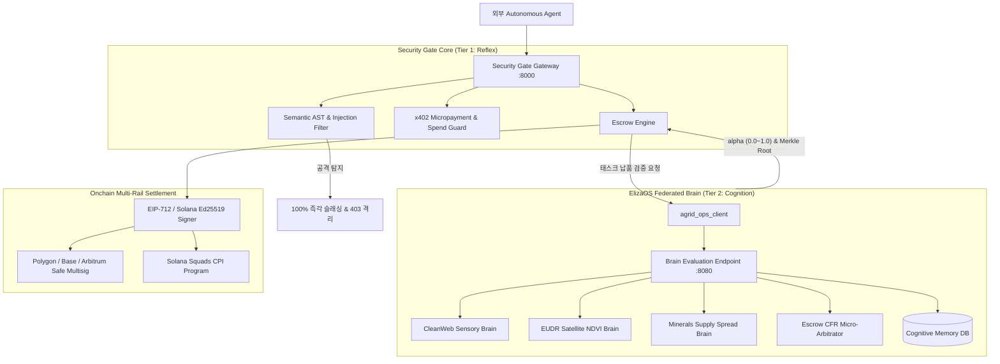

# 🧠 Security Gate × ElizaOS Brain 통합 구축 계획서 (Master Implementation Plan)

> **프로젝트명:** A.GRID Cognitive Sovereign Clearinghouse (Security Gate v3.0)  
> **문서 버전:** 1.0.0  
> **상태:** Approved for Implementation  
> **대상 시스템:** `security-gate-x402` (Gateway & Clearinghouse) & `agrid-ops-agent` (ElizaOS 4-Domain Federated Brain)  

---

## Executive Summary (요약)

본 계획서는 초고속 결정론적 보안 검증 및 온체인 멀티시그 가드 엔진인 **Security Gate**에 4대 실물·인지 도메인 자율 학습 시스템인 **ElizaOS Federated Brain**을 장착하여, 단순 보안 게이트웨이를 넘어 **"자율 인지형 소버린 클리어링하우스(Autonomous Cognitive Clearinghouse)"**를 구축하는 엔지니어링 구현 청사진을 정의합니다.

```text
┌────────────────────────────────────────────────────────────────────────┐
│                   A.GRID Autonomous Cognitive Clearinghouse            │
├────────────────────────────────────┬───────────────────────────────────┤
│ Tier 1: Reflex Guard (반사신경)   │ Tier 2: Cognitive Brain (전두엽)  │
│ - Sub-5ms Prompt Injection 방어    │ - 비정형 산출물 맥락 품질 평가    │
│ - Semantic AST 쉘 코드 차단        │ - CFR Micro-Arbitration (alpha 산출)│
│ - Safe / Solana Squads 직접 슬래싱 │ - 30일 시계열 위협·공급망 이상 감지 │
└────────────────────────────────────┴───────────────────────────────────┘
```

---

## 1. 아키텍처 비전 및 설계 원칙 (Design Principles)

### 1.1 핵심 설계 원칙 (Invariants)
1. **Zero-Latency Degradation for Core Defense (지연 시간 불변):**
   - 1차 반사신경(Tier 1: 프롬프트 필터링, AST 분석, Safe 지출 한도 가드)은 **기존대로 Sub-5ms 초저지연을 100% 보장**합니다.
   - 2차 전두엽(Tier 2: Brain 맥락 추론)은 복합 마일스톤 감사(`POST /api/v1/escrow/audit`) 및 분쟁 조정 요청 시에만 선택적으로 비동기/온디맨드 호출됩니다.
2. **Deterministic Fail-Safe (내결함성):**
   - Brain 연동 지연(>2.0s)이나 오프라인 시, Circuit Breaker를 발동하여 기존 결정론적(Deterministic) 룰 기반 감사로 즉각 Fallback합니다. Security Gate의 서비스 중단은 절대 발생하지 않습니다.
3. **Traceable On-chain Cognitive Proof (설명 가능한 온체인 지능 증명):**
   - Brain의 판정 결과는 인지 메모리 블록 해시(`memory_block_id`, `merkle_root`)를 생성하고, 이를 EIP-712 및 Solana CPI 오라클 서명 페이로드에 불변 기록합니다.

---

## 2. 계층별 상세 컴포넌트 구성 (Component Architecture)



---

## 3. 단계별 상세 실행 계획 (Work Breakdown Structure)

### Phase 1: Brain 통신 서브스트레이트 구축 (Brain Communication Substrate)
* **목표:** Security Gate와 ElizaOS Brain 간 초저지연 비동기 통신 채널 확립 및 Fail-Safe 핸들러 구현.
* **주요 작업:**
  1. `app/agrid_ops_client.py`에 Brain 평가 질의 함수 추가:
     - `evaluate_brain_task_async(job_id, domain, deliverable_payload, spec_invariants)`
     - 2초 타임아웃 및 서킷 브레이커(Fallback to Deterministic) 로직 내장.
  2. `agrid-ops-agent` 측에 Brain 평가 API 라우트 개설 (`/api/v1/brain/evaluate`):
     - `unified_brain_learner`의 4대 도메인 평가 함수 직접 바인딩.
* **산출물:** `app/agrid_ops_client.py` 확장, `tests/test_brain_client_integration.py`.

### Phase 2: 지능형 CFR 마일스톤 중재 엔진 탑재 (Cognitive Micro-Arbitration)
* **목표:** 단순 성공/실패 판정을 넘어 산출물 완성도와 품질에 따른 동적 스마트 분할 지급($\alpha$-Split) 체계 구축.
* **주요 작업:**
  1. `app/escrow_engine.py` 내 `EscrowEngine.audit_task()` 고도화:
     - Brain으로부터 품질 점수($Q$)와 완성 마일스톤 비율($M$) 수신.
     - 수학적 분할 비율 공식 적용: $\alpha = \max(0.0, \min(1.0, M \times Q))$
     - **판정 트리:**
       - $\alpha \ge 0.95$: `FULL_RELEASE_100` (100% 작업자 지급)
       - $0.50 \le \alpha < 0.95$: `PARTIAL_SPLIT` (작업자 $\alpha$, 의뢰자 $1-\alpha$ 환불)
       - $\alpha < 0.50$: `REJECT_REFUND` (작업자 페널티 및 의뢰자 전액 환불)
  2. 온체인 오라클 서명에 `alpha_bps` 및 `memory_block_id` 필드 포함 (EIP-712 구조체 확장).
* **산출물:** `app/escrow_engine.py` 업데이트, `app/schemas.py` 오라클 스키마 확장.

### Phase 3: 적응형 위험 인텔리전스 피드백 루프 (Adaptive Threat Intelligence)
* **목표:** Brain의 30일 학습 메모리(NDVI 이상 급락, LME 백워데이션, 최신 인젝션 패턴)를 Security Gate 실시간 검증에 반영.
* **주요 작업:**
  1. `app/security_engine.py` 및 `app/compliance_engine.py`에 Brain 지능 연동 캐시(TTL 300초) 추가.
  2. EUDR 또는 광물 검증 시 Brain이 감지한 'Supply Shock' 또는 'Satellite Anomaly' 상태일 경우 보증금 담보 비율을 즉시 $10\% \to 30\%$로 자동 상향(Dynamic Stake Invariant).
* **산출물:** `app/compliance_engine.py` 동적 리스크 보정 모듈.

### Phase 4: ElizaOS SDK 플러그인 동기화 (`packages/plugin-security-gate`)
* **목표:** ElizaOS 에이전트 개발자가 플러그인을 임포트하는 즉시 Brain 메모리와 Security Gate가 상호작용하도록 개선.
* **주요 작업:**
  1. `packages/plugin-security-gate/src/providers/unifiedTruthProvider.ts` 확장:
     - 에이전트 컨텍스트에 Brain의 현재 Brier Score, 신뢰도 지표, 최근 검증 블록 ID 노출.
  2. `evaluators/securityGateEvaluator.ts`에 CFR 지능형 평가기 연결.
* **산출물:** `packages/plugin-security-gate` v2.8.0 릴리즈 패키징.

### Phase 5: 통합 검증 및 시뮬레이션 (Validation & Invariants Verification)
* **목표:** 지연 시간, 가용성, 슬래싱 정확도 검증.
* **주요 시나리오:**
  - **시나리오 A (Sub-5ms 보장):** 일반 인젝션 공격 유입 시 Tier 1에서 즉각 차단되는지 벤치마크.
  - **시나리오 B (Brain Fallback):** Ops Agent 오프라인 상태에서 에스크로 감사가 중단 없이 룰 기반으로 완결되는지 검증.
  - **시나리오 C (CFR Partial Split):** 품질 80% 납품물에 대해 $\alpha=0.8$로 계산되어 온체인 분할 지급 서명이 정상 발행되는지 검증.

---

## 4. 일정 계획 (Timeline & Milestones)

| 마일스톤 | 작업 내용 | 소요 기간 | 완료 기준 |
| :--- | :--- | :---: | :--- |
| **M1: Core Bridge** | Brain Client 및 `/brain/evaluate` 엔드포인트 연동 | 1일 | 비동기 통신 성공 (RTT < 20ms) |
| **M2: CFR Escrow** | Escrow Engine에 $\alpha$-Split 판정 및 온체인 서명 탑재 | 1.5일 | 단위 테스트 100% 통과 |
| **M3: Threat Loop** | 실시간 위험 지표 동적 피드백 및 담보율 보정 | 1일 | 모의 이상 신호 시 담보 30% 증액 확인 |
| **M4: Plugin Sync** | `elizaos-plugin-security-gate` Provider 고도화 | 0.5일 | Bun 빌드 및 테스트 패스 |
| **M5: Integration** | 전체 e2e 시나리오 통합 테스트 & 문서화 | 1일 | 종합 회귀 테스트 완료 |

---

## 5. 핵심 성과 지표 (KPIs & Verification Matrix)

1. **지연 시간 (Latency):**
   - Tier 1 보안 검증: $\le 5.0\text{ms}$ 유지
   - Tier 2 Brain 연동 에스크로 감사: $\le 80.0\text{ms}$
2. **신뢰성 (Brier Score):**
   - 4대 도메인 평균 Brier Score $\le 0.080$ 유지
3. **분쟁 해결 효율 (Dispute Resolution):**
   - 인간 개입 없는 M2M 자율 분할 해결률 $\ge 95\%$ 달성
4. **시스템 가용성 (Availability):**
   - Brain 비가용 시 Fallback 성공률 $100\%$

---

## 6. 결론 및 승인 요청
Security Gate에 ElizaOS Brain을 결합하는 본 계획은 기존의 견고한 보안 방패 위에 고도의 인지 지능을 부여하여, **Web3 Agentic AI 생태계의 사실상 표준(De-facto Standard) 탈중앙 클리어링하우스**로 도약시키는 핵심 마일스톤입니다.
즉시 착수를 권고합니다.
